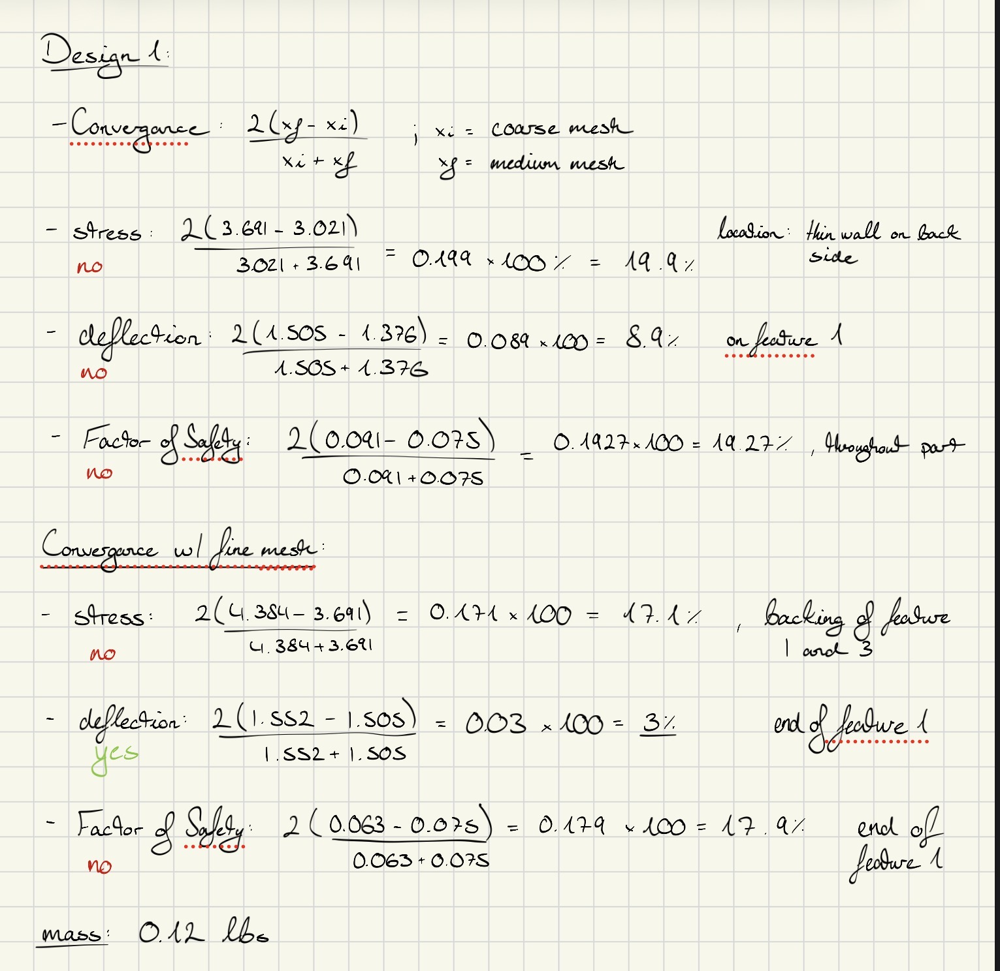
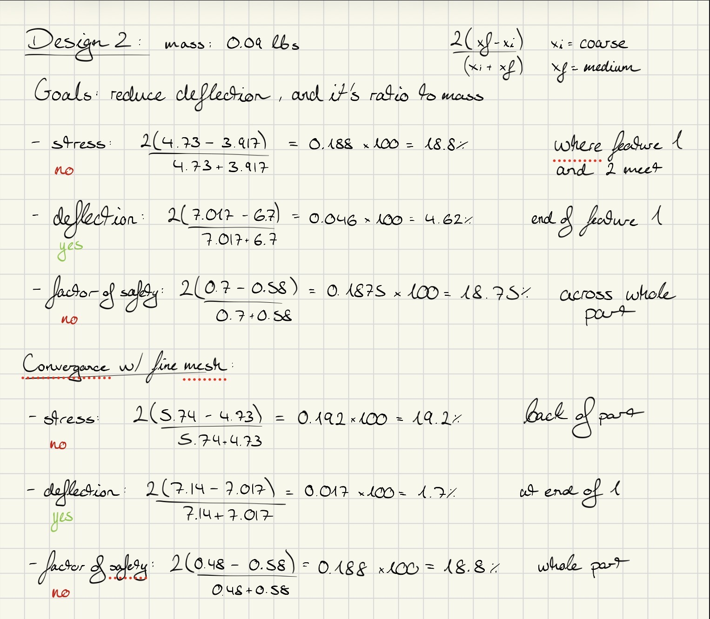
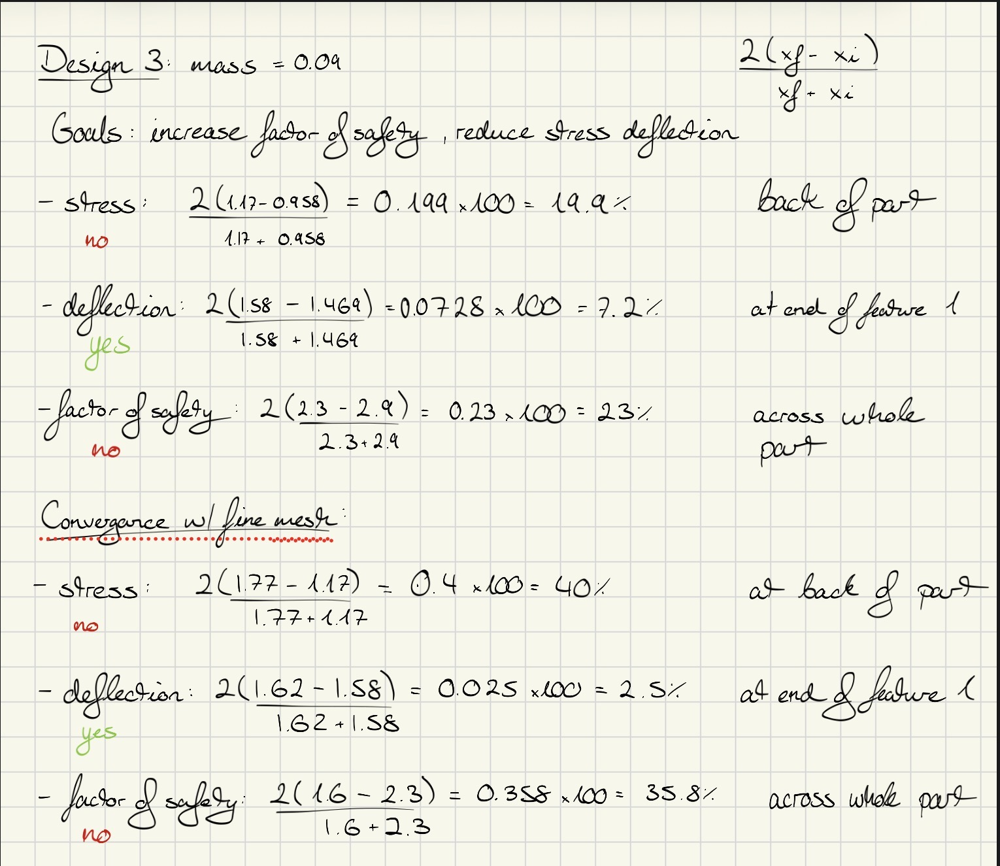
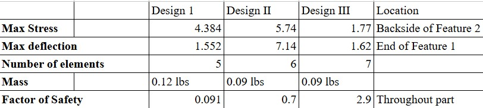

# A7 – FEA on Bracket

## **Objective**  
The main objective of this assignment is to use Finite Element Analysis to improve the bracket design from previous two assignments. Doing this will ensure high stiffness, and lightweight optimization through iterative design, whilst simultaneously conducting multiple FEA simulations, refining geometry based on results. In addition, perform static stress analysis with constraints, loading, and meshing sections. Identifying maximum stress, displacement and safety factors to optimize design by modifying geometry to enhance performance. Lastly, documenting the entire process with images and calculations to help reflect on key engineering lessons learned and total time spent on the project.  

## **Analyze**  
Firstly, I started by running a static simulation in Solidworks for my first iteration of my design and seeing where my base line was. This was purely to see where I could improve, simulate my part to failure, and see where I optimize the overall geometry of my part.  
Computations for each design to determine converengence of less than 7 % difference between each FEA mesh changes.  
  
  
  

## A7 Documented design procedure  
<object data="A7DesignProcedureResults.pdf" type="application/pdf" width="100%" height="800px">
    
Your browser does not support inline PDFs. <a href="A7DesignProcedureResults.pdf">Click here to view or download the A3 parametric design screenshots PDF</a>.

</object>  

## Final tabulation for critical metrics throughout design process  
Tabulation of each outer-loop iteration for the following metrics:  
  

## **Decide**  
I decided that I was going to use Design 3 as my final design for my motor mount because it demonstrated light weight capabilities, underwent the maximum deflection and stress compared to the first two design loops, as well as is the part with the highest safety factor amongst the three. 

## **Communicate**  
In total over the course of the week I spent around 8 hours doing calculations, designing, running simulation loops multiple times for each design iteration, and lastly writing and updating page accurately represent my assignment and research. 

## Links to CAD files  

