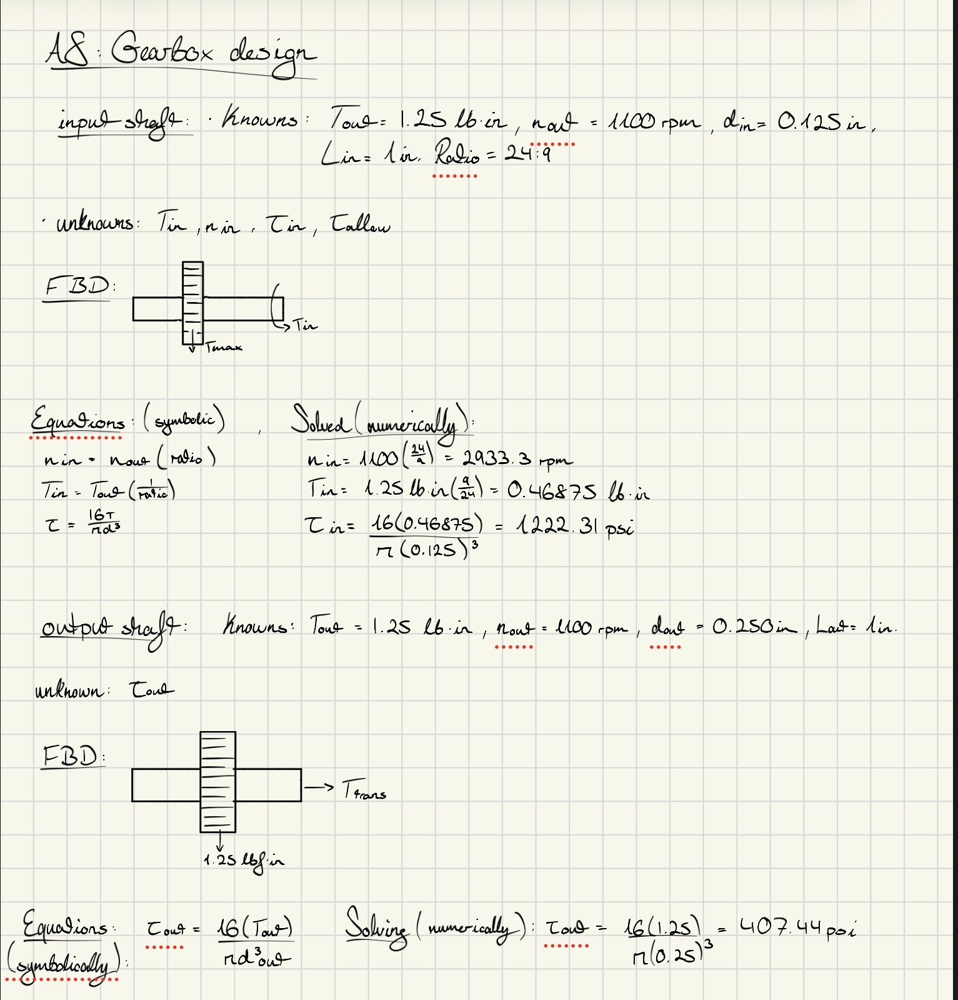
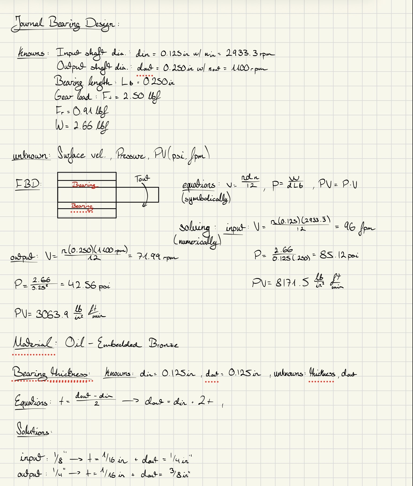
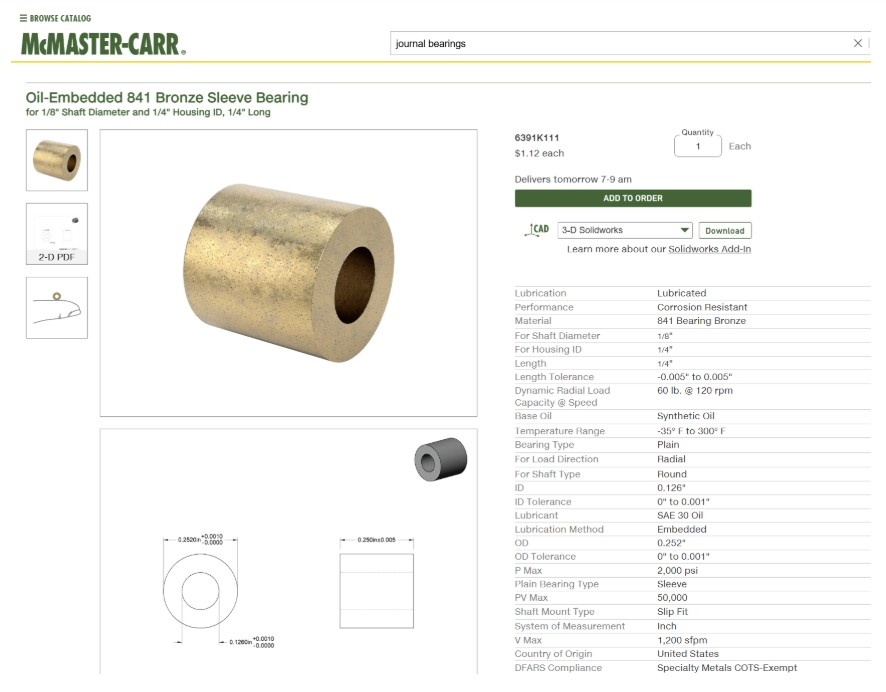
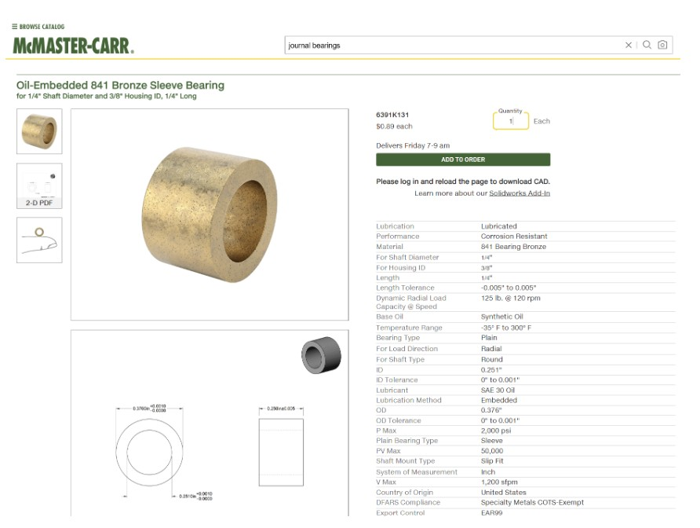
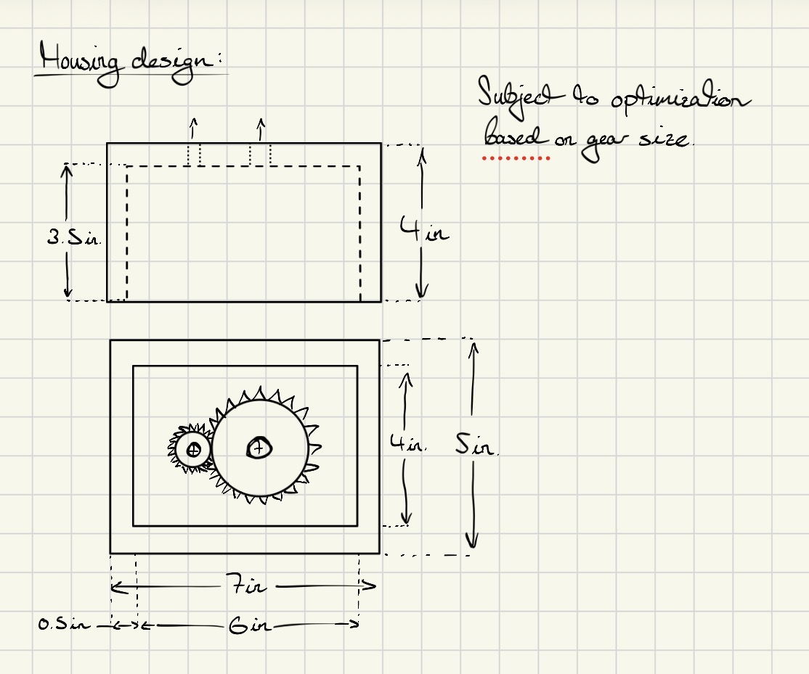

# A8 – Gear Box

## Objective  
The main objective of this assignment is to design a gearbox which can be assembled and disassembled given the description of the gears provided. The spur gears have a gear ratio of 24:9 and are listed in the resource section of this assignments instructions. The output gear torque and speed are to be 1.25 in-lbf and 1100 rpm relative. The input and output shaft diameters are .125 and .25 inches respectively and each have a length of 1 inch. We are supposed to use the appropriate equations from the Machinery's Handbook for empirical units. The critical features of the gearbox include the shafts, and the journal bearings. Note that shafts are press fit through the hubs of the gears, making sure there is enough clearance between the gears and the gearbox, and using a running sliding fit for the size of the hole for the shafts.  

## Analyze  

## Shafts  
  
Input and Output shaft dimensions **were sufficient** for this process to handle the shear stress of the torque / torsion created by the transmission of energy between the two gears.  

## Journal Bearings  
  
The two bearings I selected for my shafts were made of bronze because it had the lowest amount of friction and is generally a good bearing material for being resistance to thermal wear. Additionally there were the perfect size and length according to PV measurements I had calculated above that allowed to optimize my design the best I could to meet the required goals for this assignment.  

1/8" Shaft Journal Bearing:  
  

1/4" Shaft Journal Bearing: 
  

## Drawing of Gearbox Housing  

  

# Photographic Album of Design Process  
Within this PDF below includes pictures of the different design approaches, as well the assembly on the gearbox and mistakes I ran into along the way whilst trying to mesh the two gears together.  

<object data="A8_Procedure_Progress.pdf" type="application/pdf" width="100%" height="800px">
    
Your browser does not support inline PDFs. <a href="A8_Procedure_Progress.pdf">Click here to view or download the A8_Procedure_Progress PDF</a>.

</object>  

## Decide  
For my final design I opted for a flush glued lid (with a gasket) to sit against the gearbox. Given more time I would have liked to optimized a bit more in regards to the size of the gearbox to make it more visually satisfying with the gears inside with an appropriate size ratio. I also would have liked to run an FEA on my design to eliminate high stress areas by changing the geometry. Whilst in this one, deflection and safety factor weren't as important it is still good insight to have whilst designing a product and be able to think of the many different scenarios it could be applied to where such factors might be considered. Lastly, I decided I didn't need to run parametric values since the intention of the design was for it be as simple as possible and because nothing in this assignment is exceptionally critical, I did not need to extensively parametrically model the gearbox because it would have been a waste of time for little or no impact on the final assembly. Whilst on the other hand, if I was designing the gear / sprocket, I would have preferred to design it parametrically given all the different design choices needed to optimize such a part to harness its fullest potential.  

## Communicate  
Lessons Learned: I believe some lessons learned during this assignment were to being able to more efficiently optimize the shape of my gearbox based on its intention and purpose. For example, adding fillets in the gearbox to eliminate high stress points and allow gear oil to move around to lubricate gears inside the gearbox. Little thoughts and analytics like that go a long way in making a good product. I spent around 8 hours on this assignment between modeling different designs for my gearbox as well gathering the data and putting my website together in a manner that is presentable and professional.  

## CAD files 
<a href="A8_Gearbox.SLDPRT" download>Download SolidWorks Gearbox Housing</a>  
<a href="A8_Gearboxasm.SLDASM" download>Download SolidWorks Gearbox Assembly</a>  

