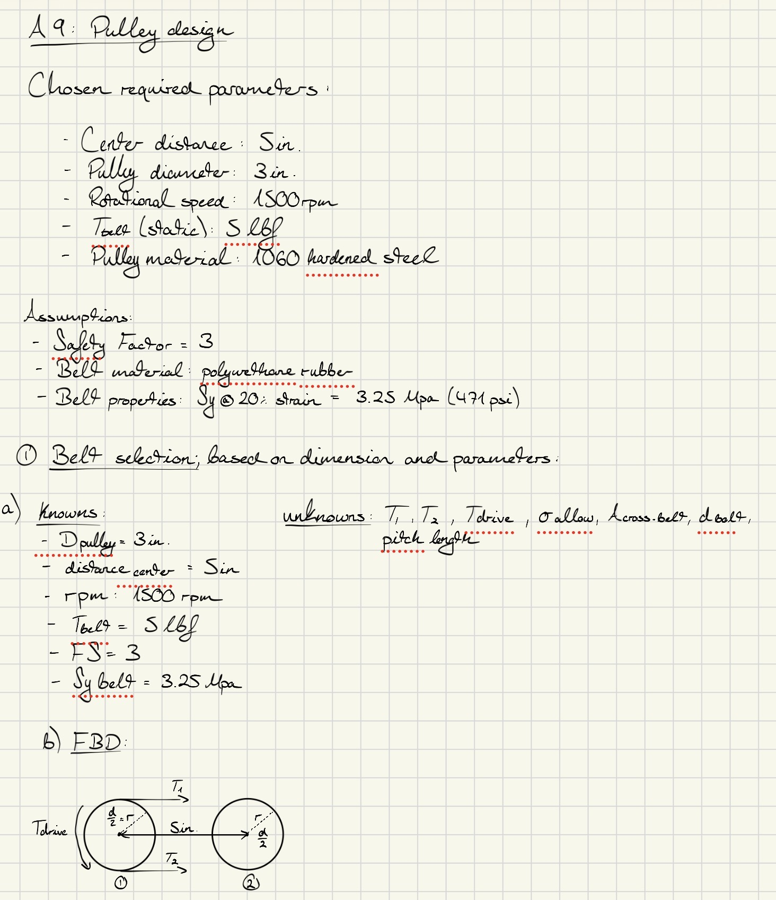
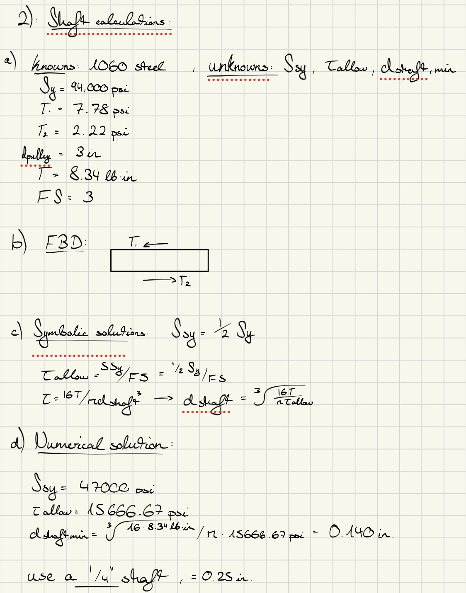
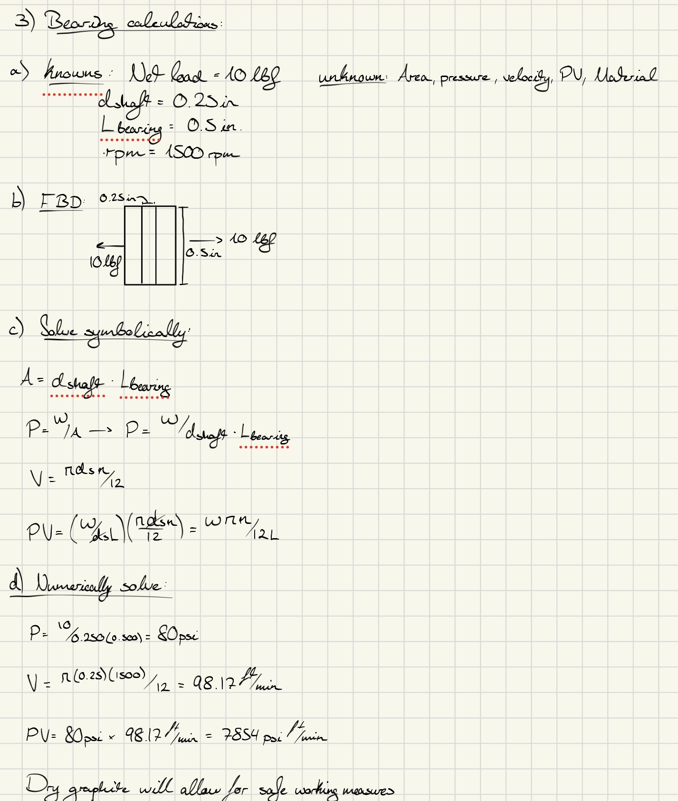
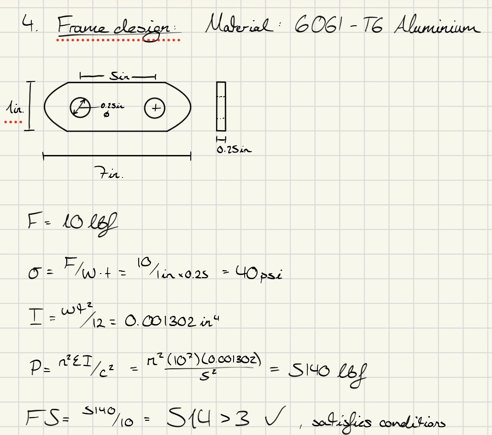

# A9 – Pulleys

## Objective  
The objective of this week's assignment is to design a pulley system to transfer power between two parallel axes separated by a center distance of 4-6 inches and it must meet the following requirements:  
- Pulley Diameter: 3 inches  
- Rotational Speed: 1000 - 2000 rpm  
- Belt Tension (Static): Select a belt tension between 4-6 lbf under stationary conditions  
- Material: Pulleys may be made from aluminum, ABS, or steel and may include a groove and shaft diameter of my choosing (must be within reasonable manufacturing limits)  
- Safety Factor: The design must satisfy a minimum safety factor of 3  

Assumptions: Assume the belt is made from polyurethane rubber with a yield strength of 3.25 MPa or 471 psi at 20% strain.  

## Analyze  

Belt Calculations:  
  

Shaft Calculations:  
  

Bearing Calculations:  
  

Frame Design:  
  
## Decide

## Communicate

