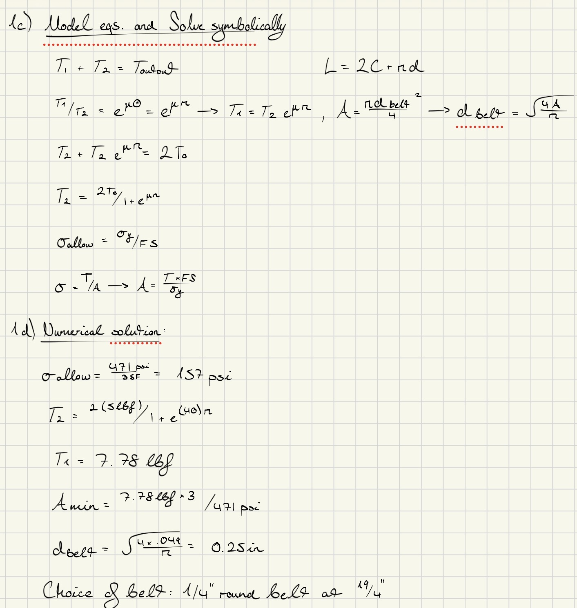

# A9 – Pulleys

## Objective  
The objective of this week's assignment is to design a pulley system to transfer power between two parallel axes separated by a center distance of 4-6 inches and it must meet the following requirements:  
- Pulley Diameter: 3 inches  
- Rotational Speed: 1000 - 2000 rpm  
- Belt Tension (Static): Select a belt tension between 4-6 lbf under stationary conditions  
- Material: Pulleys may be made from aluminum, ABS, or steel and may include a groove and shaft diameter of my choosing (must be within reasonable manufacturing limits)  
- Safety Factor: The design must satisfy a minimum safety factor of 3  

Assumptions: Assume the belt is made from polyurethane rubber with a yield strength of 3.25 MPa or 471 psi at 20% strain.  

## Analyze  

## Belt Calculations:  
  
  
To begin the assignment, I started by following the instructions and calculating the torques based on the properties I was given in the instructions as well as the material properties for the belt itself. I designed the belt around the top half of the pulley like we had discussed in class because it would be easier to do so rather than solving from the bottom up. After playing with the equations to solve symbolically for my desired unknowns, I had to physically look up what the static coefficient between a polyurethane belt and 1060 hardened steel would be to make sure that there was not too much force from the belt acting onto the pulley so that it may function correctly. My final choice of belt was had a circumference of 19 1/4" with a diameter of 1/4". Absolutely good enough for its purpose as a critical component of a functioning system.  

Link to choice of belt (3044K606):  https://www.mcmaster.com/3044K606-1835T382/  

## Shaft Calculations:  
  
Next on the list was to thoroughly calculate the shaft for the pulley and its properties so that it appropriately interacts with the components around it such as the bearing and pulley itself. Given the known parameters and material properties I was able to start playing around with equations to find my valuable unknowns. This procedure followed a similar process as the belt before it. This time I was particularly focused on the minimum diameter needed for the shaft to fit and properly interact within the bearing. Calculating for allowable shear stress along the way given our safety factor of 3. A hardened piece of 1060 steel with a 1/4" in diameter can easily be found anywhere.  

## Bearing Calculations:  
  
Once again following a similar procedure to the first two items above. The instructions on the assignment asked us to reference the Machinery's Handbook Table 4 on pg. 2440 to locate the pressure and linear velocity related to material properties to select an appropriate bearing material for our the mating of the shaft and pulley. I decided to select a Dry Graphite Bearing because it reduces friction without the need for lubricant or grease which allows it be maintenance free for a certain amount of time until they need to be replaced. For a small pulley system like this a part like this does need to be super over-complicated or engineered because of the working load on the system. This bearing was along perfectly within the safety factor range.  

## Frame Design:  
  
Lastly, following the same procedure above, this part of the assignment asked us to be more creative and design a frame for this pulley system. We were given inspiration in the assignment instructions, but I took inspiration from a industrial sized chain link plate that I had seen during my internship over the summer. This design is a fairly lightweight and robust support piece to help withstand the vibrations and weight of the pulleys and belt on it. In the calculations above, I proved it is within the safety factor we are looking for. It was given enough material around the shaft holes and fillets edges to disperse and reduce the amount of stress on the part entirely allowing it be a perfectly viable option for this system.  

## Decide  
In conclusion, I decided to opt for the 3044K606 19 1/4" belt from McMaster parts online, and the 0.5 in. long Dry Graphite bearing with a .250 bore to fit the shaft for my bearing selection.  

## Communicate  
Engineering lesson learned: One lesson I learned during this assignment was to take material properties, formulas and create a design that didn't necessarily involved CAD and allowed us to put everything on paper first before translating it online. This assignment helped me understand the value of using pen and paper first and solving for material properties to make an educated decision rather than just guessing and hoping it works. The time, money, and effort can be saved just by thinking more critically about what is going on in the system first before getting excited and throwing it into CAD or looking for parts. Additionally I learned more in-depth about how critical components of a pulley interact and what is the thought process in designing one that can meet certain parameters and goals.  

